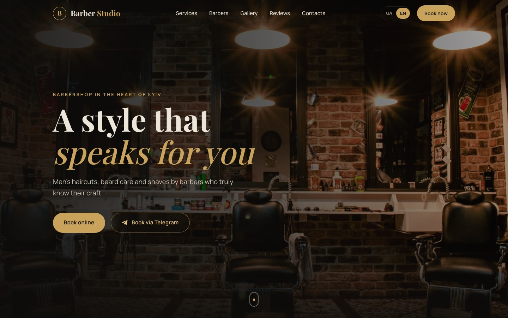
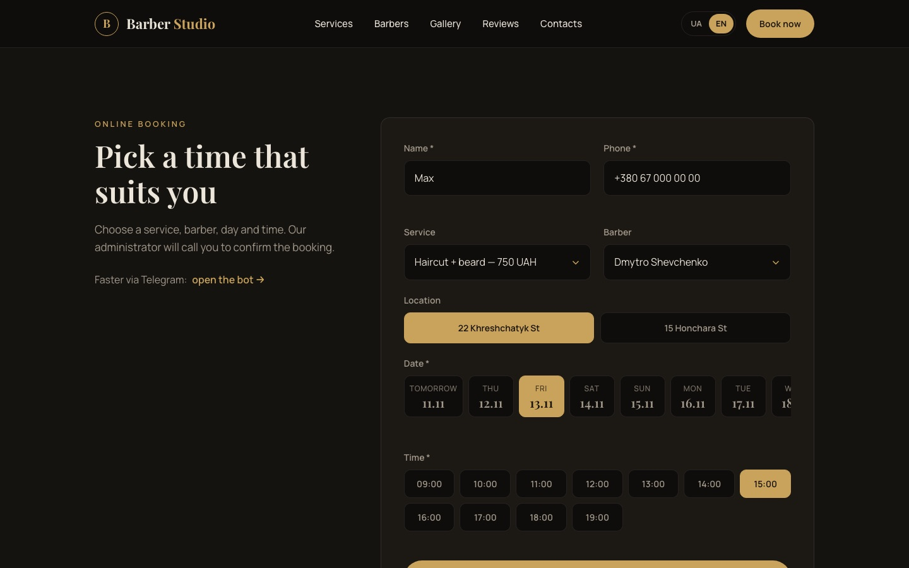
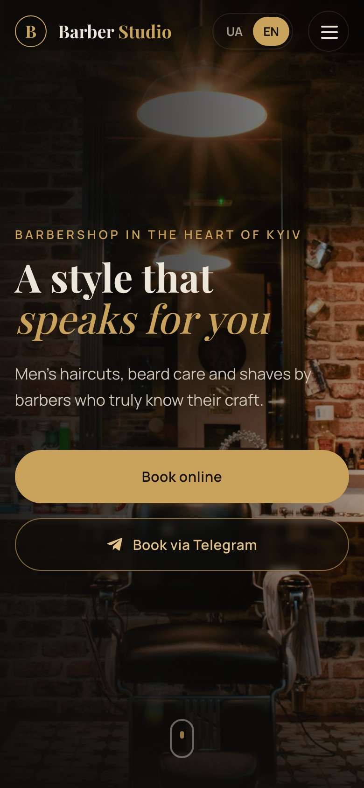
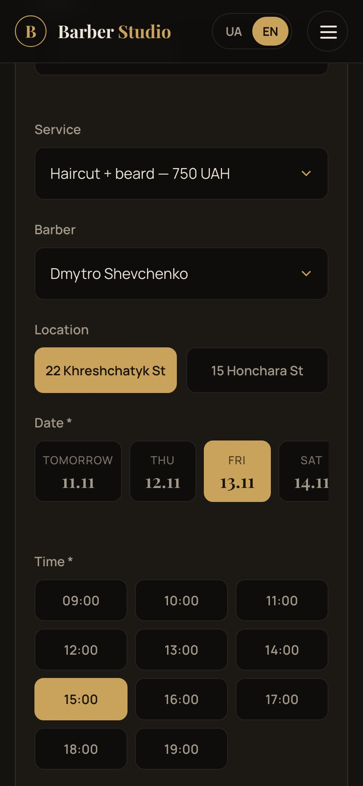

# Barber Studio — Barbershop Landing Page

A responsive one-page website for **Barber Studio**, a (fictional) barbershop in Kyiv, Ukraine.
Built as a portfolio demo project with plain HTML, CSS and vanilla JavaScript — no frameworks, no build step. Online booking runs on a small serverless backend (Cloudflare Worker + D1) and delivers requests to the admins' Telegram.

**Live demo:** https://blessedrbls.github.io/barbershop-site/?lang=en (English) · [Ukrainian version](https://blessedrbls.github.io/barbershop-site/)

## Features

- **Dark, modern design** with a warm gold accent, Google Fonts (Playfair Display + Manrope), smooth scrolling and fade-in animations on scroll
- **Fully responsive** — mobile, tablet and desktop layouts, burger menu on small screens
- **Two languages:** Ukrainian (default) and English, switchable with the UA / EN toggle in the header; the choice is remembered in the browser, and a `?lang=en` link opens the English version directly. All texts live in one dictionary in `script.js`
- **Telegram booking:** "Book via Telegram" buttons on the hero screen and in the services section. The bot link is stored in one variable (`TELEGRAM_BOT_URL` in `script.js`)
- **Services & prices** — haircut, beard, haircut + beard, kids' haircut
- **Barbers** — three team cards with photo, experience and specialization
- **Gallery** — 6 photos in a grid, click to open a full-size lightbox (keyboard arrows and Esc supported)
- **Reviews** with star ratings
- **Contacts** — two branches (22 Khreshchatyk St, 15 Honchara St), opening hours, phone, and an embedded Google Map that switches between branches
- **Online booking with a real schedule** — pick a service, barber, location, day (2 weeks ahead) and an hourly time slot. Slots follow the opening hours and the service length (e.g. a 90-minute service can't start an hour before closing), and past hours are hidden for today, using Kyiv time
- **No double bookings** — pick a barber and only their free hours are shown, and a Cloudflare D1 database guarantees that two people can't book the same barber at the same time, even if they press the button simultaneously. "Any barber" is auto-assigned to the least busy free barber
- **Telegram admin buttons** — every request arrives with ✅ Confirm / ❌ Cancel buttons; cancelling frees the time on the site
- **Booking requests straight to Telegram** — the form is validated and delivered instantly to the barbershop's admin group in Telegram via a small Cloudflare Worker. The bot token stays secret on the server side and never appears in the site's code. Works in demo mode until the Worker URL is added
- Accessibility basics: semantic HTML, alt texts, keyboard focus styles, `prefers-reduced-motion` support

## Screenshots

| Desktop | Booking: only the barber's free hours |
| --- | --- |
|  |  |

| Mobile | Mobile booking |
| --- | --- |
|  |  |

## Tech stack

- HTML5
- CSS3 (Flexbox, Grid, custom properties, media queries)
- Vanilla JavaScript (ES6+, IntersectionObserver, `<dialog>`, Fetch API)
- [Google Fonts](https://fonts.google.com/)
- [Cloudflare Workers](https://workers.cloudflare.com/) + [D1](https://developers.cloudflare.com/d1/) (SQLite) + [Telegram Bot API](https://core.telegram.org/bots/api) for bookings, availability and admin notifications
- Google Maps embed

## How to run

No installation needed. Download or clone the repository and open `index.html` in any modern browser.

```bash
git clone https://github.com/blessedrbls/barbershop-site.git
cd barbershop-site
open index.html   # macOS; or just double-click the file
```

The booking form only talks to the Worker from allowed addresses, so to try booking locally serve the folder over HTTP instead of opening the file directly:

```bash
python3 -m http.server 8080   # then open http://localhost:8080
```

## Configuration

All settings are at the top of `script.js`:

| Variable | What it does |
| --- | --- |
| `TELEGRAM_BOT_URL` | Link to the Telegram booking bot used by every "Book via Telegram" button |
| `BOOKING_ENDPOINT` | URL of your Cloudflare Worker (e.g. `https://barber-booking.<you>.workers.dev`). Not a secret. Leave empty for demo mode |

### Telegram booking notifications

```
Website form  ⇄  Cloudflare Worker  →  Telegram Bot API  →  admin group chat
                 (keeps the bot token      ✅ Confirm / ❌ Cancel buttons
                  secret, stores bookings   call the Worker back)
                  in D1)
```

The Worker code is in [`telegram-worker/worker.js`](telegram-worker/worker.js). The bot token and chat ID are stored as Worker secrets (`BOT_TOKEN`, `CHAT_ID`), never in the repository. The Worker only accepts requests from allowed origins, validates every field and escapes user input. Step-by-step setup (free, about 15 minutes, no CLI needed): [`telegram-worker/SETUP.md`](telegram-worker/SETUP.md).

## Project structure

```
barbershop-site/
├── index.html    # page markup (all sections)
├── style.css     # styles, animations and responsive layout
├── script.js     # translations, Telegram link, menu, gallery, map, form
├── images/       # photos (see credits below)
├── telegram-worker/
│   ├── worker.js # Cloudflare Worker: bookings in D1, free hours, Telegram buttons
│   └── SETUP.md  # setup guide
└── README.md
```

## Photo credits

All photos are from [Unsplash](https://unsplash.com) and are used under the free [Unsplash License](https://unsplash.com/license).

| File | Photo | Author |
| --- | --- | --- |
| `images/hero.jpg` | [Black leather barber chair near brown brick wall](https://unsplash.com/photos/EW_rqoSdDes) | [Nathon Oski](https://unsplash.com/@onatecan) |
| `images/master-1.jpg` | [Man holding scissors](https://unsplash.com/photos/taZSJ6xmt48) | [Eugene Chystiakov](https://unsplash.com/@eugenechystiakov) |
| `images/master-2.jpg` | [Barber styling a client's hair](https://unsplash.com/photos/T_gTN3Po9RQ) | [Jeppe Mønster](https://unsplash.com/@jeppemoenster) |
| `images/master-3.jpg` | [A man with a beard is getting his hair cut](https://unsplash.com/photos/cmoQYMqGgoI) | [Glib Albovsky](https://unsplash.com/@albovsky) |
| `images/gallery-1.jpg` | [A man cutting another man's hair with scissors](https://unsplash.com/photos/tgPrIYnW3g4) | [Nate Johnston](https://unsplash.com/@natejohnston) |
| `images/gallery-2.jpg` | [Barber trimming hair with straight razor](https://unsplash.com/photos/1Pmp9uxK8X8) | [Agustin Fernandez](https://unsplash.com/@agustinfernandez) |
| `images/gallery-3.jpg` | [Barber trimming a man's beard](https://unsplash.com/photos/fE42nRlBcG8) | [Nathon Oski](https://unsplash.com/@onatecan) |
| `images/gallery-4.jpg` | [Barber blow-drying a client's hair](https://unsplash.com/photos/8esvJeVUdes) | [delfina pan](https://unsplash.com/@delfipan) |
| `images/gallery-5.jpg` | [Barber trimming hair with thinning shears](https://unsplash.com/photos/DrG4V5skbMY) | [Gulom Nazarov](https://unsplash.com/@modelyano) |
| `images/gallery-6.jpg` | [Man cutting hair of man](https://unsplash.com/photos/Q82AM6BWBPM) | [Michael DeMoya](https://unsplash.com/@demoya) |

Barber names, reviews, phone number and other business details on the site are fictional and used for demo purposes only.

---

**Need a website like this? Contact me on Telegram: [@nonelyyo](https://t.me/nonelyyo)**
